# Importação de registros via CSV

Componente LWC (`csvImport`) que importa registros de **qualquer SObject** a partir de um arquivo CSV. O mapeamento entre as colunas do arquivo e os campos do Salesforce não fica no código: ele é configurado no Custom Metadata **CSV Import Mapping** (`CSVImportMapping__mdt`). Assim, dá para criar novas importações sem deploy de código.

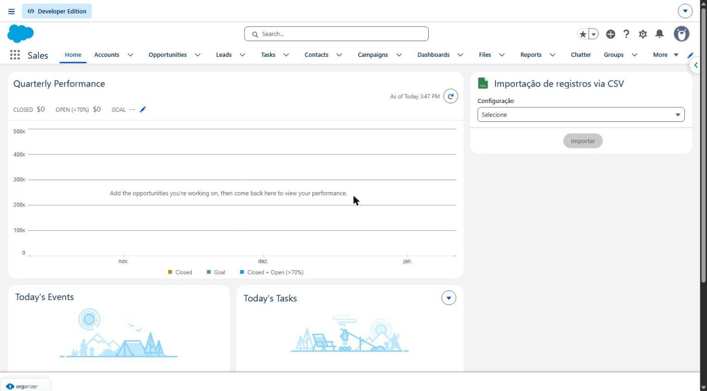

---

## Sumário

- [Funcionalidades](#funcionalidades)
- [Arquitetura](#arquitetura)
- [Instalação](#instalação)
- [Configuração (Custom Metadata)](#configuração-custom-metadata)
- [Formato do arquivo CSV](#formato-do-arquivo-csv)
- [Como usar](#como-usar)
- [Tratamento de erros](#tratamento-de-erros)
- [Conversão de tipos](#conversão-de-tipos)
- [Segurança](#segurança)
- [Testes](#testes)
- [Limitações e pontos de atenção](#limitações-e-pontos-de-atenção)
- [Troubleshooting](#troubleshooting)

---

## Funcionalidades

- Seleção da **configuração de importação**. Cada configuração define um objeto e o seu mapeamento de colunas.
- Exibição das **colunas esperadas** para a configuração escolhida.
- Botão **Baixar modelo**, que gera um CSV vazio só com o cabeçalho certo.
- Upload por botão ou por *drag & drop*, com contagem de linhas lidas.
- Detecção automática do separador (`;` ou `,`) e suporte a campos entre aspas, como `"Construtora Silva; Filhos"`.
- Leitura de arquivos em **UTF-8** ou **Windows-1252** (o "CSV" padrão do Excel em português), sem quebrar acentos.
- Validação do cabeçalho antes de importar: se faltar alguma coluna esperada, a importação é bloqueada.
- Envio em **lotes de 200 linhas**. Cada lote é uma transação própria, com seus próprios limites de governor.
- Importação parcial (*all-or-none = false*): as linhas válidas são gravadas e as inválidas são reportadas.
- Tabela de erros por linha e botão **Baixar erros**, que exporta as linhas que falharam com os dados originais e uma coluna `Erro`.
- Toast de resumo, por exemplo `4 registros importados, 2 com erro`.

---

## Arquitetura

```
┌─────────────────────────────┐        ┌──────────────────────────────┐
│ LWC csvImport               │        │ CsvImportController (Apex)   │
│                             │ wire   │                              │
│ • combobox de configuração  │◄───────┤ getConfigurations()          │
│ • leitura/parse do CSV      │        │   (cacheable)                │
│ • tabela de erros           │ call   │                              │
│ • download modelo / erros   ├───────►│ importRecords(config, rows)  │
│                             │ 1 por  │   → Map<linha, erro>         │
│                             │ lote   │                              │
└─────────────────────────────┘        └──────────────┬───────────────┘
                                                      │ getAll()
                                       ┌──────────────▼───────────────┐
                                       │ CSVImportMapping__mdt        │
                                       └──────────────────────────────┘
```

| Artefato | Tipo | Responsabilidade |
|---|---|---|
| `csvImport` | LWC | Interface, leitura do arquivo, parse do CSV, envio em lotes e exibição dos resultados |
| `CsvImportController` | Apex (`with sharing`) | Lê o mapeamento, converte os valores e insere os registros |
| `CsvImportControllerTest` | Apex Test | Cobertura do controller |
| `CSVImportMapping__mdt` | Custom Metadata Type | Mapeamento coluna do CSV → campo do objeto |

### Métodos do controller

| Método | Descrição |
|---|---|
| `getConfigurations()` | `@AuraEnabled(cacheable=true)`. Retorna `Map<String, List<String>>` com a configuração e as colunas dela. Usa `getAll()`, então não consome SOQL. Alimenta o combobox e o texto "Colunas esperadas". |
| `importRecords(String configuration, List<Map<String,String>> rows)` | `@AuraEnabled`. Recebe um lote de linhas já parseadas pelo LWC (coluna → valor), valida o objeto e os campos, converte os tipos e faz **um único** `Database.insert(records, false, AccessLevel.USER_MODE)`. Retorna `Map<Integer, String>` com o índice da linha no lote e a mensagem de erro. Se o mapa vier vazio, todas as linhas do lote foram importadas. |
| `convert(DisplayType, String)` | `@TestVisible`. Converte o texto para o tipo do campo (veja [Conversão de tipos](#conversão-de-tipos)). |

### Estrutura do projeto

```
force-app/main/default/
├── classes/          CsvImportController, CsvImportControllerTest
├── customMetadata/   registros de exemplo da configuração "Contas"
├── lwc/csvImport/    componente
└── objects/          CSVImportMapping__mdt e seus campos
data/                 CSVs de exemplo (contas_exemplo.csv, contas_sucesso.csv)
```

---

## Instalação

```bash
sf project deploy start --source-dir force-app --target-org <alias> --test-level RunSpecifiedTests --tests CsvImportControllerTest
```

Depois do deploy:

1. Dê acesso à classe `CsvImportController` aos usuários (Permission Set ou Profile).
2. No **Lightning App Builder**, arraste o componente **Importação CSV** para uma página (Home, App, Record ou Tab) e ative a página.

> O deploy já cria a configuração de exemplo `Contas`. Se não quiser essa configuração na org, remova a pasta `customMetadata/` antes de fazer o deploy.

---

## Configuração (Custom Metadata)

Cada registro de **CSV Import Mapping** representa **uma coluna** de uma configuração. Os registros com o mesmo valor em `Configuration` formam uma importação.

| Campo | API Name | Descrição | Exemplo |
|---|---|---|---|
| Configuration | `Configuration__c` | Nome da configuração que aparece no combobox | `Contas` |
| CSV Column | `CsvColumn__c` | Nome exato da coluna no cabeçalho do CSV | `Receita Anual` |
| Field API Name | `FieldApiName__c` | Campo de destino | `AnnualRevenue` |
| Object API Name | `ObjectApiName__c` | Objeto de destino (precisa ser o mesmo em todos os registros da configuração) | `Account` |

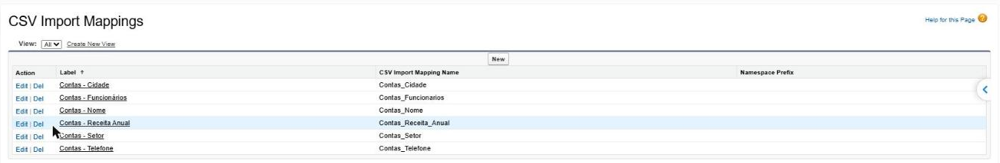

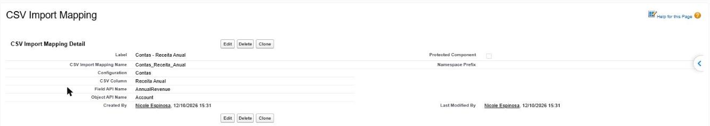

### Configuração de exemplo: `Contas`

| Coluna do CSV | Campo (Account) |
|---|---|
| Nome | `Name` |
| Funcionários | `NumberOfEmployees` |
| Receita Anual | `AnnualRevenue` |
| Setor | `Industry` |
| Telefone | `Phone` |
| Cidade | `BillingCity` |

### Criando uma nova configuração

1. Vá em **Setup → Custom Metadata Types → CSV Import Mapping → Manage Records**.
2. Clique em **New** e crie **um registro por coluna**, usando o mesmo valor em `Configuration` (por exemplo, `Contatos`).
3. Preencha `CSV Column`, `Field API Name` e `Object API Name`.
4. Recarregue a página. A nova configuração aparece no combobox, sem nenhuma alteração de código.

> **Dica:** o `Object API Name` e o `Field API Name` são validados em tempo de execução contra o describe. Um objeto ou campo inexistente interrompe a importação com `Objeto inválido: <objeto>` ou `Campo inválido: <campo>`.

---

## Formato do arquivo CSV

| Regra | Detalhe |
|---|---|
| Separador | `;` ou `,`, detectado automaticamente pelo cabeçalho |
| Encoding | UTF-8 (com ou sem BOM) ou Windows-1252 |
| Cabeçalho | Obrigatório na 1ª linha, com os nomes **exatos** das colunas configuradas, incluindo acentos e maiúsculas. Colunas extras são ignoradas. |
| Aspas | Use quando o valor tiver o separador ou quebra de linha, por exemplo `"Transportes Rápido; Cia"`. Para aspas dentro do valor, use `""`. |
| Números | Aceita o formato brasileiro (`1.200.000,50`) ou o internacional (`1200000.50`) |
| Datas | `dd/MM/aaaa` (padrão do locale do usuário) ou `aaaa-MM-dd` |
| Valores vazios | O campo é ignorado (não é gravado) |
| Linhas em branco | Ignoradas |

Exemplo (`data/contas_sucesso.csv`):

```csv
Nome;Funcionários;Receita Anual;Setor;Telefone;Cidade
Farmácia Vida Saudável;18;620.000,00;Healthcare;(11) 4002-8922;Campinas
Agro Campos Verdes;150;8.750.000,00;Agriculture;(62) 3214-5678;Goiânia
"Transportes Rápido; Cia";320;22.400.000,75;Transportation;(48) 3025-9090;Florianópolis
```

> Para não errar o cabeçalho, use o botão **Baixar modelo** no próprio componente.

---

## Como usar

### 1. Acesse o componente

Abra a página onde o componente foi adicionado (nos exemplos abaixo, a **Home**). No estado inicial, só o combobox de configuração aparece e o botão **Importar** fica desabilitado.

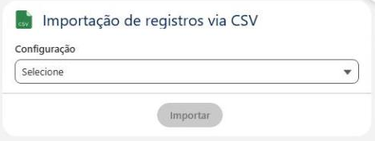

### 2. Selecione a configuração

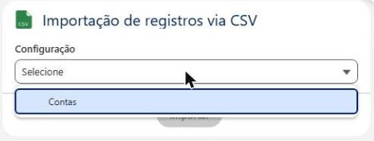

Depois de escolher a configuração, o componente mostra as **colunas esperadas**, o botão **Baixar modelo** e a área de upload.

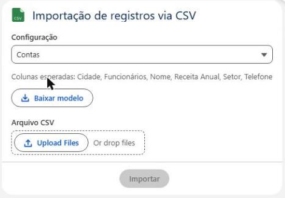

### 3. Envie o arquivo CSV

Clique em **Upload Files** ou arraste o arquivo. O componente mostra o nome do arquivo e quantas linhas de dados foram lidas, sem contar o cabeçalho. O botão **Importar** fica habilitado.

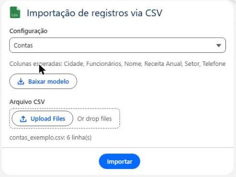

### 4. Importe

Clique em **Importar**. Se faltar alguma coluna esperada no arquivo, a importação é bloqueada e um toast lista as colunas que faltam. Senão, as linhas são enviadas em lotes de 200, com uma barra de progresso, e ao final um toast mostra o resumo.

**Tudo certo:** toast verde e nenhuma tabela de erros.

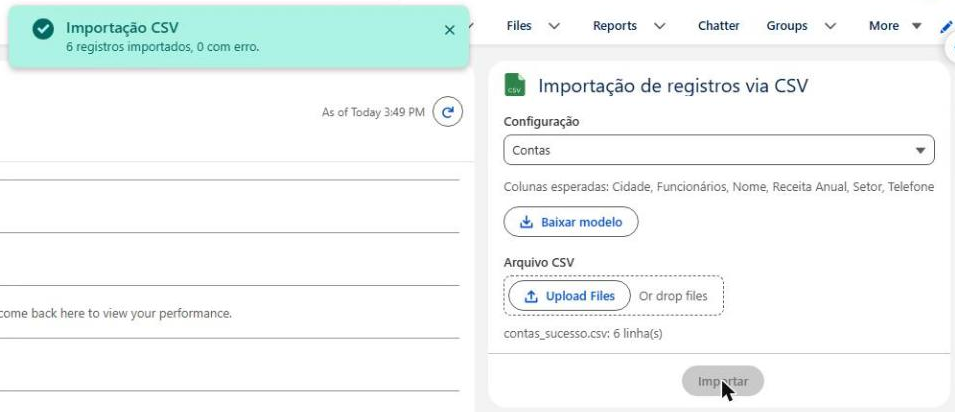

**Importação parcial:** toast de alerta e tabela com a linha e o motivo de cada erro. As linhas válidas **são gravadas**. Use **Baixar erros** para exportar só as linhas com problema, corrigir e importar de novo.

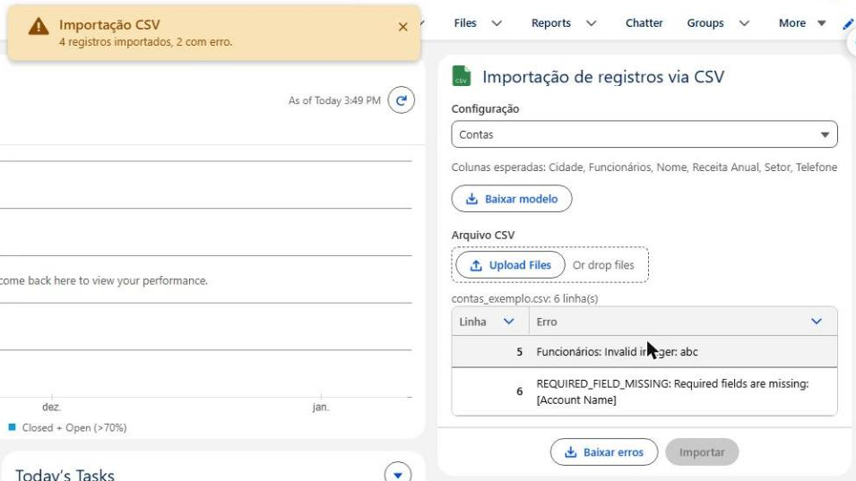

Depois de uma importação, o botão **Importar** fica desabilitado até você escolher outro arquivo ou outra configuração. Isso evita importar o mesmo arquivo duas vezes.

### 5. Confira os registros

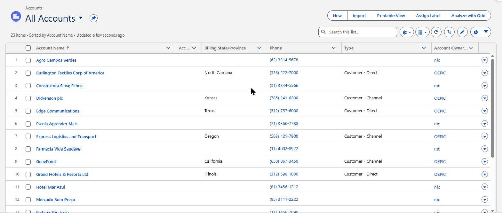

Os valores são convertidos para o tipo do campo. Por exemplo, `1.100.000,00` vira `$1,100,000` em *Annual Revenue*, e `Education` vai para *Industry*.

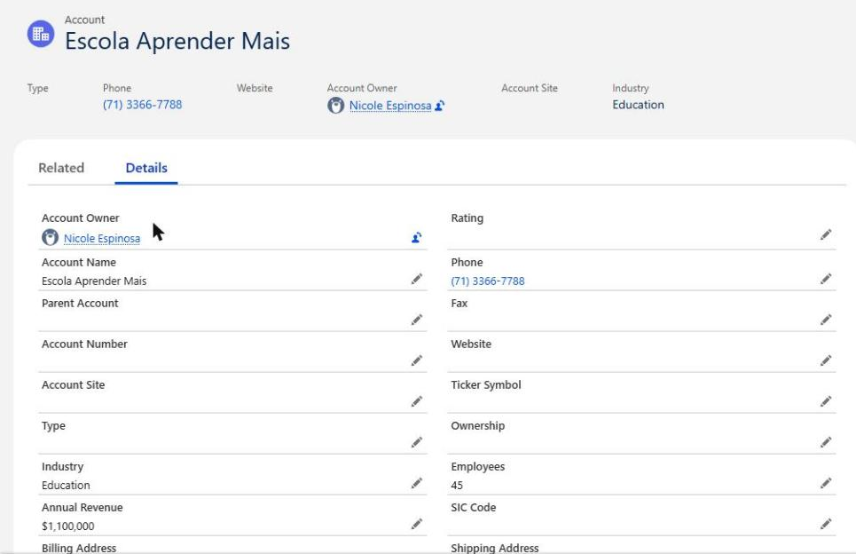

---

## Tratamento de erros

A coluna **Linha** da tabela de erros segue a numeração do arquivo, em que a linha 1 é o cabeçalho. Assim fica fácil achar o registro no Excel ou no editor.

| Origem | Exemplo de mensagem | Causa |
|---|---|---|
| Cabeçalho (LWC) | `Colunas não encontradas no arquivo: Setor` | O CSV não tem uma coluna configurada. Nada é importado. |
| Conversão (Apex) | `Funcionários: Invalid integer: abc` | Valor incompatível com o tipo do campo. A linha não é enviada ao banco. |
| Banco de dados | `REQUIRED_FIELD_MISSING: Required fields are missing: [Account Name]` | Campo obrigatório vazio |
| Duplicate Rules | `DUPLICATES_DETECTED: Use one of these records?` | O registro já existe e a regra de duplicidade bloqueia |
| Validation Rules / Triggers | `FIELD_CUSTOM_VALIDATION_EXCEPTION: ...` | Regras da org |
| Configuração | `Configuração não encontrada: X` | Não há registros de CMDT com essa configuração |
| Configuração | `Objeto inválido: X` | `ObjectApiName__c` não existe na org |
| Configuração | `Campo inválido: X` | `FieldApiName__c` não existe no objeto |

Os erros de **banco de dados** vêm no formato `STATUS_CODE: mensagem`.

> Os erros de **configuração** lançam `AuraHandledException` e interrompem a importação. Os lotes que já tinham sido enviados continuam gravados. Os erros de **linha** só afetam a linha correspondente.

Exemplo com o arquivo `data/contas_exemplo.csv` importado de novo (as contas já existiam), em que as Duplicate Rules bloquearam as linhas repetidas:

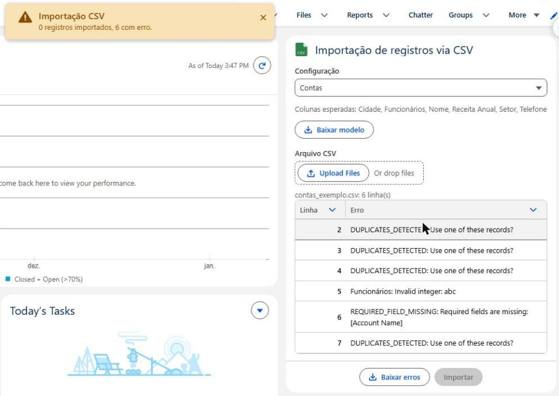

---

## Conversão de tipos

| Tipo do campo | Regra |
|---|---|
| `BOOLEAN` | `true`, `1`, `sim`, `s`, `yes`, `x` → `true` (sem diferenciar maiúsculas). Qualquer outro valor vira `false`. |
| `INTEGER` | `Integer.valueOf` |
| `DOUBLE`, `CURRENCY`, `PERCENT` | Se o valor tem `,`, remove os `.` e troca `,` por `.` (formato pt-BR). Se não tem, usa `Decimal.valueOf` direto. |
| `DATE` | Com `/` → `Date.parse` (locale do usuário). Sem `/` → `Date.valueOf` (`aaaa-MM-dd`). |
| `DATETIME` | Com `/` → `Datetime.parse` (locale do usuário). Sem `/` → `Datetime.valueOf` (`aaaa-MM-dd HH:mm:ss`). |
| Demais (Text, Picklist, Phone, Lookup por Id…) | Valor em texto, sem conversão |

Os valores passam por `trim()` antes da conversão. Valores em branco não são atribuídos ao registro.

---

## Segurança

- O controller é `with sharing`, então respeita as regras de compartilhamento do usuário.
- O insert usa `AccessLevel.USER_MODE`, o que aplica **CRUD e FLS** do usuário logado.
- O usuário precisa de acesso à classe `CsvImportController` (Permission Set ou Profile).

---

## Testes

Execute a classe de teste pelo VS Code ou pelo SF CLI:

```bash
sf apex run test --class-names CsvImportControllerTest --result-format human --code-coverage --target-org <alias>
```

| Método | Cenário |
|---|---|
| `shouldReturnColumnsByConfiguration` | Agrupamento das colunas por configuração |
| `shouldImportValidRowsInBulkAndReturnErrors` | 202 linhas numa chamada: 200 válidas, 1 erro de conversão e 1 erro de DML |
| `shouldRejectInvalidMappings` | Configuração inexistente, objeto inválido e campo inválido |
| `shouldConvertValuesByFieldType` | Todos os tipos tratados pelo `convert` |

Cobertura atual do `CsvImportController`: **100%**.

O `mappings` é `@TestVisible`, então os testes podem injetar registros de `CSVImportMapping__mdt` em memória, sem depender dos registros da org.

---

## Limitações e pontos de atenção

- **Somente insert.** Não há upsert ou update por External ID.
- **Volume:** o arquivo é lido no navegador e enviado em lotes de 200 linhas, um após o outro. Arquivos com milhares de linhas funcionam, mas o usuário precisa manter a página aberta até o fim. Uma falha num lote interrompe os lotes seguintes, e os anteriores continuam gravados.
- **Lookups** só funcionam com o Id do registro (não há resolução por nome ou External ID).
- **Datas no formato `dd/MM/aaaa`** dependem do locale do usuário (`Date.parse`).
- **Booleanos:** qualquer valor fora da lista de verdadeiros vira `false`, sem erro.
- **Um objeto por configuração.** Um `Object API Name` diferente entre registros da mesma configuração não é validado: vale o objeto do primeiro registro.
- **Ordem das colunas:** em "Colunas esperadas" e no **Baixar modelo**, as colunas seguem a ordem devolvida pelo Custom Metadata, e não uma ordem definida.
- **Número da linha:** pode desalinhar se o CSV tiver linhas em branco no meio ou células com quebra de linha entre aspas.

---

## Troubleshooting

| Sintoma | Verifique |
|---|---|
| Configuração não aparece no combobox | O CMDT tem registros com o `Configuration` preenchido? Recarregue a página, porque o método é cacheable. |
| `Colunas não encontradas no arquivo` | O cabeçalho do CSV bate **exatamente** com o `CSV Column`, incluindo acentos e maiúsculas? |
| Acentos quebrados (`Funcionários`) | O arquivo foi salvo num encoding que não é UTF-8 nem Windows-1252. Salve de novo como **CSV UTF-8**. |
| `DUPLICATES_DETECTED` | Os registros já existem. Ajuste a Duplicate Rule ou remova as linhas duplicadas. |
| Receita importada com valor errado | Confira o formato do número: `1.200.000,50` (pt-BR) ou `1200000.50` |
| Comportamento antigo depois de um deploy | O navegador está usando o JS em cache. Recarregue com **Ctrl+F5**. |
